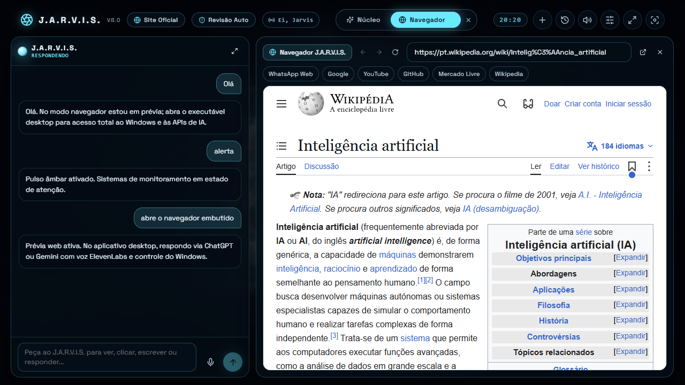
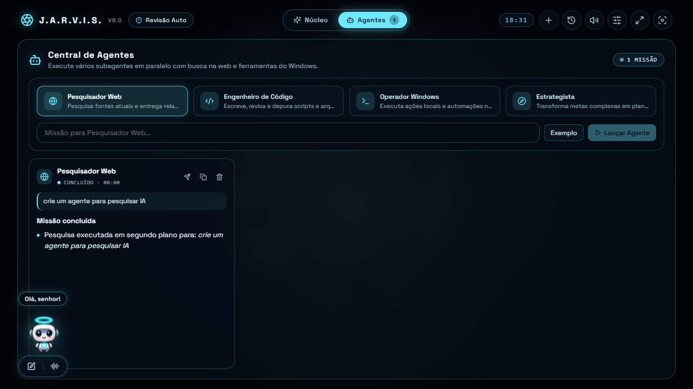

<div align="center">


# J.A.R.V.I.S.

**THE SINGULARITY EDITION · V8.0**

### Seu Windows. Sua voz. Seu copiloto.

Um assistente de desktop para jogar, navegar e programar — com voz,<br />
visão de tela e uma interface que parece ter saído da ficção científica.

[](https://github.com/k48w/Jarvis/releases/tag/v8.0.0)
[](https://jarvis-cinematic.vercel.app/)

[](#-comece-por-aqui)
[](src-tauri/tauri.conf.json)
[](src-tauri/src)
[](package.json)
[](src/Stage.tsx)
[](LICENSE)

[Experiência](#-conheça-o-cockpit) · [Recursos](#-o-que-você-pode-fazer) · [Instalação](#-comece-por-aqui) · [Desenvolvimento](#-para-quem-quer-construir-junto) · [English](#english)


<sub>Núcleo de plasma reativo à voz · Interface de desktop · Quatro temas visuais</sub>

</div>

---

## ✨ Conheça o cockpit

Diga **“Ei, Jarvis”**, peça ajuda com uma janela aberta ou acompanhe uma pesquisa enquanto continua trabalhando. O J.A.R.V.I.S. reúne conversa, ferramentas do Windows e contexto dos seus projetos em uma interface com personalidade própria.

O núcleo muda entre repouso, escuta, processamento, resposta e alerta. Um mascote flutuante acompanha o desktop, mostra mensagens e oferece atalhos. Quando uma tarefa precisa de mais espaço, os painéis de navegador, agentes e alterações de código entram em cena.

<table>
<tr>
<td width="50%" valign="top">
<strong>🌐 Navegação lado a lado</strong><br />
<sub>Conversa e navegador na mesma interface. Imagem da prévia web.</sub><br /><br />

</td>
<td width="50%" valign="top">
<strong>🤖 Central de agentes</strong><br />
<sub>Painel de tarefas e notificações do mascote. Imagem de demonstração.</sub><br /><br />

</td>
</tr>
</table>

> **Quer conhecer antes de instalar?** [Abra a demonstração no navegador](https://jarvis-cinematic.vercel.app/). Ela apresenta a interface; IA, voz e controle do Windows exigem o aplicativo desktop e os serviços configurados. Sem WebGL2, a prévia usa uma esfera estática.

## ⚡ O que você pode fazer

| Você quer… | O Jarvis reúne… |
| :--- | :--- |
| **Conversar sem parar o que está fazendo** | Ativação por “Ei, Jarvis”, captura nativa de microfone, transcrição e respostas por voz. |
| **Pedir ajuda com um jogo ou aplicativo** | Descoberta de janelas e captura direcionada para dar contexto visual ao assistente. |
| **Navegar com acompanhamento** | WebView2 integrado, conversa em tela dividida e ferramentas para inspecionar, clicar, digitar e navegar. |
| **Delegar uma pesquisa** | Subagentes em segundo plano, acompanhamento de tarefas e avisos de conclusão. |
| **Trabalhar em um projeto** | Pastas vinculadas, leitura e edição de arquivos, diff colorido e opção de desfazer alterações. |
| **Usar o que já está na sua tela** | Leitura da área de transferência, prints com `Ctrl+V` e anexos por arrastar e soltar. |
| **Deixar o assistente por perto** | Mascote arrastável, janela sempre no topo, balões de resposta e menu de ações rápidas. |

### Experimente pedir

Estes são exemplos de pedidos para o aplicativo configurado. A execução depende do provedor, do contexto disponível e do modo de permissão.

> 🎮 **“Jarvis, olha meu jogo e me ajuda a entender o que está acontecendo.”**
>
> 📋 **“Analisa o que eu copiei e explica os pontos principais.”**
>
> 🌐 **“Abre o navegador aqui do lado e pesquisa sobre esse assunto.”**
>
> 💻 **“Leia os arquivos deste projeto e proponha uma correção.”**
>
> 🤖 **“Crie um agente para pesquisar esse tema enquanto continuamos.”**

### A estética faz parte da experiência

**Stark Cyan · Arc Gold · Quantum Violet · Crimson Core**

Esfera de plasma com shaders GLSL, anéis giroscópicos, paralaxe, espectro de voz e modo imersivo. A qualidade visual é configurável; a fluidez depende da GPU, da resolução e dos recursos em uso.

<details>
<summary><strong>Por dentro: voz, visão e ferramentas nativas</strong></summary>

- **Voz:** captura Win32 `waveIn`, detecção local de atividade de voz (VAD), transcrição por ElevenLabs Scribe ou Gemini e síntese ElevenLabs com cache local e modos de economia.
- **Visão:** enumeração de janelas, captura por `PrintWindow` e alternativas via DXGI/GDI. Alguns jogos ou janelas minimizadas podem precisar ser restaurados e receber foco; a compatibilidade varia conforme o aplicativo.
- **Navegação:** WebView2 com ferramentas de controle via Chrome DevTools Protocol (CDP).
- **Arquivos:** contexto de projeto, busca, leitura, escrita, edição e visualização de diferenças.
- **Desktop:** mouse e teclado via `SendInput`, área de transferência nativa e janelas dedicadas para o mascote e o navegador.

Explore a [arquitetura detalhada](docs/ARCHITECTURE.md), o [motor de áudio](docs/audio.md) e as [integrações nativas](docs/native.md).

</details>

## 🚀 Comece por aqui

**Você precisa de:** Windows 10 ou 11 **x64**, WebView2 Runtime e acesso aos serviços de IA que escolher configurar. Para o núcleo 3D, use uma GPU e drivers compatíveis com WebGL2/DirectX 11.

### 1. Baixe o aplicativo

| Opção | Download |
| :--- | :--- |
| **Instalador Windows · v8.0.0** | [JARVIS_8.0.0_x64-setup.exe](https://github.com/k48w/Jarvis/releases/download/v8.0.0/JARVIS_8.0.0_x64-setup.exe) |
| **Executável independente · v8.0.0** | [JARVIS.exe](https://github.com/k48w/Jarvis/releases/download/v8.0.0/JARVIS.exe) |
| **Notas e arquivos da versão** | [GitHub Releases](https://github.com/k48w/Jarvis/releases/tag/v8.0.0) |

O instalador está configurado para baixar o WebView2 Runtime quando necessário. O executável independente também depende desse runtime.

### 2. Conecte sua IA

Abra **Ajustes → IA** e configure uma das integrações disponíveis:

| Integração | Configuração no aplicativo |
| :--- | :--- |
| **ChatGPT** | Fluxo de login OAuth implementado no projeto. Disponibilidade e limites dependem da conta e do serviço. |
| **Google Gemini** | Chave de API ou fluxo de autenticação Google, conforme a configuração escolhida. |
| **ElevenLabs** | Credenciais e voz em **Ajustes → Voz**, para os recursos de áudio correspondentes. |

**O código do Jarvis é distribuído sob MIT.** Serviços externos podem exigir conta, assinatura ou créditos próprios; eles não estão incluídos no aplicativo.

### 3. Escolha como o Jarvis pode agir

| Modo | Comportamento |
| :--- | :--- |
| **Somente Conversa** | Desativa ações locais no PC e leitura de hardware. |
| **Revisão Automática** | Leitura e pesquisa podem executar diretamente; ações que alteram o PC pedem confirmação. |
| **Permissão Total** | Permite a execução automática das ferramentas disponíveis, sujeita às proteções implementadas. |

Para conhecer o aplicativo, comece por **Somente Conversa** ou **Revisão Automática**. Depois, configure o microfone em **Ajustes → Voz** e habilite **“Ei, Jarvis”** quando quiser usar ativação por voz.

## ⌨️ Menos cliques, mais ação

| Atalho | Ação |
| :--- | :--- |
| `Alt + Space` | Mostrar ou ocultar o Jarvis; atalho configurável. |
| `Ctrl + K` | Abrir a paleta de comandos. |
| `F11` / `Alt + Enter` | Alternar tela cheia. |
| `Enter` / `Shift + Enter` | Enviar mensagem / inserir quebra de linha. |
| `Ctrl + V` | Colar um print como anexo visual. |
| `Esc` | Fechar painéis ou sair do modo imersivo. |

## 🔎 Dados, voz e permissões

O Jarvis combina componentes locais com serviços externos de IA. **Ele não é um assistente totalmente offline.**

- **Áudio:** o VAD roda localmente. Quando detecta fala, trechos podem ser enviados ao provedor de transcrição, inclusive para reconhecer o comando de ativação. Silêncio não gera envio de áudio por esse fluxo.
- **Contexto:** mensagens, imagens e conteúdo de arquivos usados nas solicitações podem ser enviados ao provedor configurado.
- **Chaves de API:** o código tenta usar o Gerenciador de Credenciais do Windows. Se esse armazenamento falhar, existe uma alternativa em `secrets.json` no diretório de dados do aplicativo, sem criptografia nesse arquivo. Não compartilhe esse diretório.
- **Ações:** os modos de permissão e as proteções de diretórios delimitam a execução das ferramentas. A disponibilidade também depende das permissões do Windows e dos aplicativos envolvidos.

Os detalhes de armazenamento estão em [`config.rs`](src-tauri/src/config.rs); as políticas de ferramentas, em [`tools.rs`](src-tauri/src/tools.rs). Consulte também a [política de segurança](SECURITY.md).

## 🛠️ Para quem quer construir junto

### Preparar o ambiente

Para o aplicativo desktop, use **Windows x64**, **Node.js 22** (versão usada no workflow), **npm**, **Rust stable com toolchain MSVC**, **Visual Studio C++ Build Tools**, **Windows SDK** e **WebView2 Runtime**.

```powershell
git clone https://github.com/k48w/Jarvis.git
cd Jarvis
npm ci
```

### Rodar durante o desenvolvimento

```powershell
# Aplicativo desktop; inicia também o servidor do frontend
npm run tauri -- dev
```

Para trabalhar somente na apresentação e na prévia web:

```powershell
npm run dev
```

Acesse `http://127.0.0.1:5173/`. Essa prévia não substitui o aplicativo desktop para testar integrações nativas.

### Validar e compilar

```powershell
# Verificação de tipos e build do frontend
npm run build

# Testes unitários do backend Rust
cargo test --manifest-path src-tauri/Cargo.toml

# Executável desktop e instalador Windows
npm run tauri -- build
```

| Saída | Local |
| :--- | :--- |
| Executável | `src-tauri/target/release/JARVIS.exe` |
| Instalador NSIS | `src-tauri/target/release/bundle/nsis/` |
| Frontend web | `dist/` |

<details>
<summary><strong>Mapa do projeto e publicação</strong></summary>

| Caminho | Responsabilidade |
| :--- | :--- |
| [`src/`](src) | Interface React, núcleo Three.js, painéis e apresentação web. |
| [`src-tauri/src/`](src-tauri/src) | Backend Rust, IA, áudio e ferramentas do Windows. |
| [`public/`](public) | Imagens e recursos estáticos do site. |
| [`docs/`](docs) | Documentação técnica e capturas da interface. |
| [`tests/`](tests) | Scripts de teste e captura com Playwright. |
| [`vercel.json`](vercel.json) | Configuração de build e publicação web. |
| [`release.yml`](.github/workflows/release.yml) | Build Windows e artefatos pelo GitHub Actions. |

O workflow Windows atual usa **acionamento manual (`workflow_dispatch`)**. Ele executa os testes Rust, compila o frontend e gera os artefatos desktop. A etapa de publicação de Release está condicionada a uma referência de tag `v*`; criar uma tag, por si só, não dispara esse workflow.

A publicação web é configurada separadamente pela integração do repositório com a Vercel.

</details>

## 🤝 Construa o próximo capítulo

Encontrou um bug? Tem uma ideia para o mascote, uma melhoria de acessibilidade ou uma integração nova? Há espaço para contribuir com código, documentação e testes no Windows.

**[Guia de contribuição](CONTRIBUTING.md) · [Reportar bug](https://github.com/k48w/Jarvis/issues/new?template=bug_report.yml) · [Sugerir recurso](https://github.com/k48w/Jarvis/issues/new?template=feature_request.yml) · [Histórico de versões](CHANGELOG.md)**

Se o projeto chamou sua atenção, deixe uma **⭐** para acompanhar sua evolução.

<a id="english"></a>
<details>
<summary><strong>English overview</strong></summary>

**J.A.R.V.I.S. — The Singularity Edition** is a Windows desktop AI companion built with Tauri 2, Rust, React 19 and Three.js.

It brings together a voice-reactive 3D core, a floating desktop mascot, voice interaction, window capture, an embedded browser, background agents and project-aware file tools with a diff viewer.

- **Get started:** download the Windows x64 app from [Releases](https://github.com/k48w/Jarvis/releases/tag/v8.0.0), configure your AI provider, and choose a permission mode.
- **Try the interface:** the [web demo](https://jarvis-cinematic.vercel.app/) is a visual preview. AI and Windows automation require the configured desktop app.
- **Know the boundaries:** cloud services may require separate accounts or credits. Voice, image and file context can be sent to the selected provider. API keys use the Windows credential store when available, with an unencrypted local-file fallback if storage fails.
- **Build locally:** install Node.js 22, Rust/MSVC and the Windows C++ build tools, then run `npm ci` and `npm run tauri -- dev`.

Source code is available under the **MIT License**. Contributions are welcome.

</details>

---

<div align="center">

<strong>Uma interface de ficção científica. Um projeto que você pode abrir, entender e transformar.</strong>

Feito por <a href="https://github.com/k48w">k48w</a> · <a href="LICENSE">MIT License</a>

</div>
