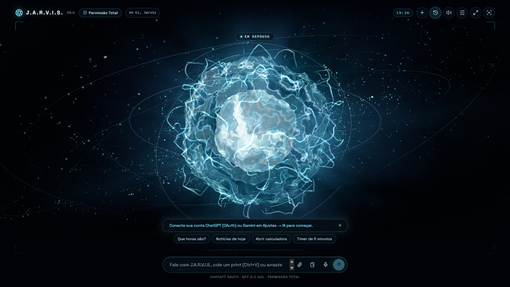

<div align="center">


# Jarvis

Assistente desktop nativo para Windows feito em Tauri 2, Rust e React.

[Baixar para Windows](https://github.com/k48w/Jarvis/releases/tag/v8.0.0) · [Prévia Web](https://jarvis-cinematic.vercel.app/) · [Arquitetura](docs/ARCHITECTURE.md)



</div>

---

## O que o Jarvis faz

- **Voz nativa no Windows** — captura via Win32 `waveIn` (16 kHz) com detecção de silêncio local (VAD), ativação por `"Ei, Jarvis"`, modo mãos-livres, transcrição (ElevenLabs Scribe ou Gemini) e voz ElevenLabs com cache em disco.
- **Visão de janelas e jogos** — lista processos abertos e captura janelas específicas com `PrintWindow` e `DXGI` (inclusive em segundo plano), além de ler prints e texto direto do `Ctrl+C`.
- **Terminal ao vivo e Git nativo** — aba de terminal PowerShell com saída em streaming e cancelamento em tempo real, ferramentas `git_status`, `git_diff`, `git_log` e `git_commit`, além de diff colorido com desfazer em 1 clique.
- **Skills (`/comando`) e rotinas agendadas** — macros reutilizáveis como `/briefing`, `/saude-pc`, `/foco` e `/git-review`, mais um agendador em segundo plano para tarefas diárias ou por intervalo.
- **Agentes em paralelo** — até 3 tarefas rodando em segundo plano ao mesmo tempo; quando um agente termina, o próprio Jarvis fala e salva um resumo curto na conversa.
- **Navegador embutido opcional** — WebView2 lado a lado com o chat quando você pede para abrir ou interagir com um site; buscas comuns acontecem silenciosamente em segundo plano.
- **Presença no desktop** — atalho global `Alt + Space`, paleta de comandos `Ctrl + K` e mascote flutuante sempre no topo.

---

## Instalação (Windows 10 / 11 x64)

1. Baixe o instalador em [GitHub Releases](https://github.com/k48w/Jarvis/releases/tag/v8.0.0):
   - **Instalador:** [JARVIS_8.0.0_x64-setup.exe](https://github.com/k48w/Jarvis/releases/download/v8.0.0/JARVIS_8.0.0_x64-setup.exe)
   - **Executável portátil:** [JARVIS.exe](https://github.com/k48w/Jarvis/releases/download/v8.0.0/JARVIS.exe)
2. Abra **Ajustes → IA** e conecte sua conta **ChatGPT (OAuth)** ou **Google Gemini (API Key / OAuth)**.
3. Opcional: em **Ajustes → Voz**, adicione sua chave **ElevenLabs** e escolha o microfone.

> O projeto é open-source sob licença MIT. Os provedores de IA e voz usam suas próprias contas/chaves e não estão incluídos no binário.

---

## Modos de permissão

| Modo | Comportamento |
| :--- | :--- |
| **Somente Conversa** | Desativa ações locais no PC e leitura de hardware. |
| **Revisão Automática** | Permite leitura e buscas; pede aprovação antes de executar comandos ou alterar arquivos. |
| **Permissão Total** | Executa as ferramentas automaticamente, mantendo bloqueios contra comandos destrutivos e pastas críticas do Windows. |

---

## Atalhos

| Atalho | Ação |
| :--- | :--- |
| `Alt + Space` | Mostrar ou ocultar o Jarvis (configurável) |
| `Ctrl + K` | Abrir paleta de comandos |
| `F11` / `Alt + Enter` | Alternar tela cheia |
| `Ctrl + V` | Colar print como anexo na conversa |
| `Esc` | Fechar painéis ou sair do modo tela cheia |

---

## Desenvolvimento local

Requisitos: Windows x64, Node.js 22+, Rust stable (MSVC), Visual Studio C++ Build Tools e WebView2 Runtime.

```powershell
git clone https://github.com/k48w/Jarvis.git
cd Jarvis
npm ci
npm run tauri -- dev
```

Para rodar os testes e gerar o build de produção:

```powershell
cargo test --manifest-path src-tauri/Cargo.toml
npm run build
npm run tauri -- build
```

Documentação técnica adicional: [Arquitetura](docs/ARCHITECTURE.md) · [Áudio](docs/audio.md) · [Integrações nativas](docs/native.md) · [Segurança](SECURITY.md)
