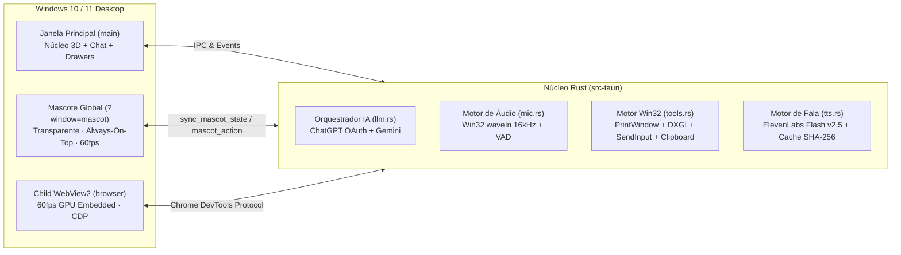
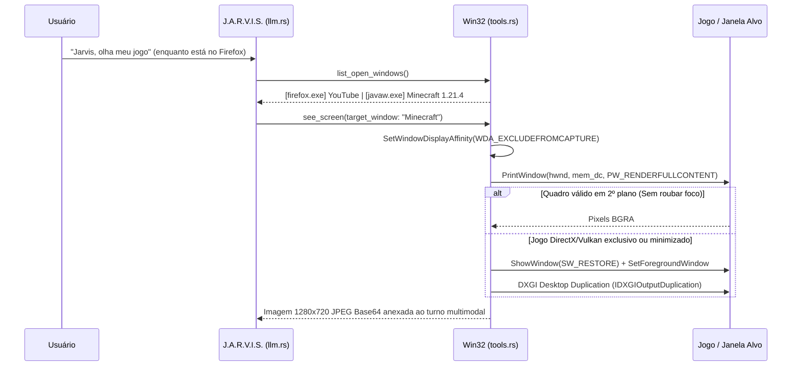
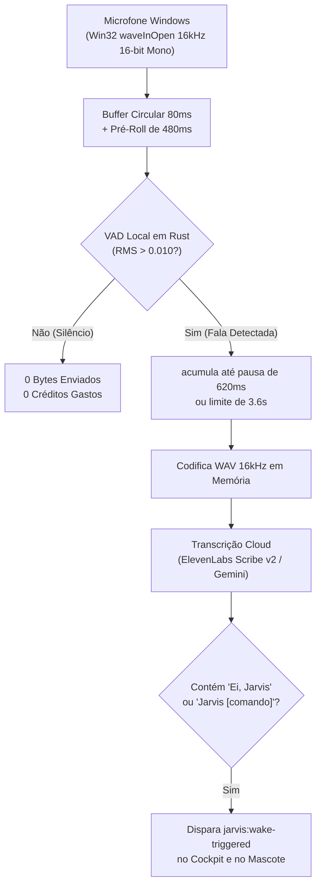

# Arquitetura de Sistema — J.A.R.V.I.S. V8.0 (The Singularity Edition)

Este documento detalha os subsistemas nativos em **Rust (Win32)** e **React 19 + Three.js (WebGL2)** que compõem o **J.A.R.V.I.S. V8.0**.

---

## 1. Visão Geral Multi-Janela (Tauri 2)

---

## 2. Pipeline de Visão Inteligente de Jogos & Janelas (`see_screen`)

---

## 3. Pipeline de Voz Nativa & Wake Word `"Ei, Jarvis"` (`mic.rs`)

