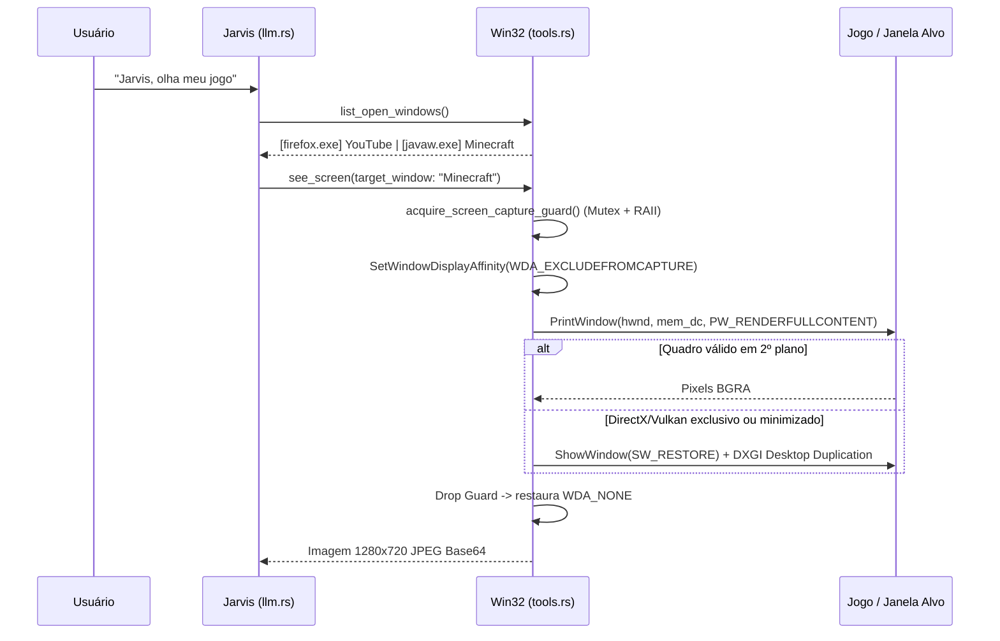
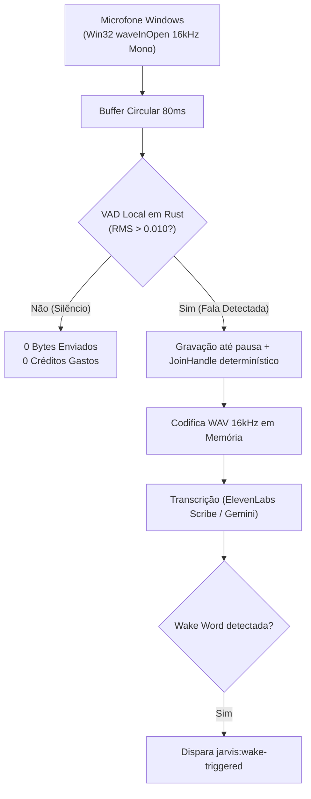

# Arquitetura de Sistema — Jarvis

Este documento descreve os subsistemas nativos em **Rust (Win32 + Tokio)** e **React 19 + Three.js (WebGL2)** que compõem o **Jarvis** para Windows.

---

## 1. Visão Geral Multi-Janela & Companion (Tauri 2)

```mermaid
flowchart LR
  subgraph Windows["Windows 10 / 11 Desktop"]
    Main["Janela Principal (main)\nNúcleo 3D + Chat + Drawers"]
    Mascot["Mascote Global (?window=mascot)\nTransparente · Always-On-Top"]
    Browser["Child WebView2 (browser)\nGPU Embedded · CDP"]
  end

  subgraph RustCore["Núcleo Rust (src-tauri)"]
    LLM["Orquestrador IA (llm.rs)\nChatGPT OAuth + Gemini"]
    Mic["Motor de Áudio (mic.rs)\nWin32 waveIn 16kHz + VAD"]
    Tools["Motor Win32 (tools.rs)\nPrintWindow + DXGI + SSRF Guard"]
    TTS["Motor de Fala (tts.rs)\nElevenLabs Flash + Cache SHA-256"]
    Comp["Servidor Companion (companion.rs)\nHTTP/SSE + Pareamento Único"]
  end

  Mobile["Celular / PWA Mobile\nChat · Deck · Tela · Aprovação 2FA"]

  Main <-->|IPC & Events| RustCore
  Mascot <-->|sync_mascot_state / mascot_action| RustCore
  Browser <-->|Chrome DevTools Protocol| RustCore
  Mobile <-->|Cookie HttpOnly + SSE (Modo LAN)| Comp
```

---

## 2. Pipeline de Visão Inteligente de Jogos & Janelas (`see_screen`)



---

## 3. Pipeline de Voz Nativa & Wake Word `"Ei, Jarvis"` (`mic.rs`)



---

## 4. Jarvis Companion — Protocolo, Segurança & Modelo de Ameaça (`companion.rs`)

### Endpoints
| Rota | Autenticação | Função |
| :--- | :--- | :--- |
| `GET /` e `/manifest.webmanifest` | Pública (503 se Companion desligado) | Serve a UI mobile PWA (`companion_ui.html`) |
| `POST /api/pair` | Código de uso único (`pairing_code`) | Valida o código, rotaciona-o na hora e emite `Set-Cookie: jarvis_session=...; HttpOnly; SameSite=Strict` |
| `GET /api/status` | Cookie `jarvis_session` / Bearer | Retorna hardware (CPU/RAM), skills, subagentes, timers, aprovação pendente e últimas mensagens |
| `GET /api/events` | Cookie `jarvis_session` / Bearer | Stream SSE (`chat`, `approval`, `approval_resolved`, `agent_summary`, `timer_fired`, `session_revoked`) |
| `POST /api/chat` / `POST /api/skill` | Cookie `jarvis_session` / Bearer | Despacha mensagem ou skill `/comando` no PC e sincroniza a UI desktop |
| `POST /api/action` | Cookie `jarvis_session` / Bearer | Controla volume/mudo, mídia, timers, cancelamento de resposta e aprovação remota (`approve`) |
| `GET /api/screen` | Cookie `jarvis_session` / Bearer | Lista janelas abertas e captura tela/janela protegida por `ScreenCaptureGuard` |

### Modelo de Ameaça e Mitigações
- **Desativado e Local por padrão**: no início do app, `enabled = false` e `lan_enabled = false` (bind em `127.0.0.1`). Enquanto desativado, todas as rotas retornam `503`. A exposição em `0.0.0.0` (LAN) exige ativação manual em **Ajustes → Celular** acompanhada de aviso explícito.
- **Limitação de Transporte (HTTP LAN)**: na rede Wi-Fi local, o servidor usa HTTP puro sem certificado TLS. Use o Modo LAN apenas em redes domésticas/privadas confiáveis e clique em **Revogar Sessões / Novo Código** sempre que terminar o uso em redes compartilhadas.
- **Ciclo de Vida de Sessão**: não há token em URL, query string ou `localStorage`. O código do QR Code (`?pair=`) é de uso único e descartado imediatamente após a troca pelo cookie `HttpOnly`.
- **Proteção contra Slowloris / Flood**: timeouts de leitura (`5s` header, `10s` corpo) e semáforos (`32` conexões HTTP e `6` streams SSE simultâneos, retornando `429` acima do limite).
- **Segredos locais**: chaves de API e tokens OAuth usam o Gerenciador de Credenciais do Windows (`keyring`) e recorrem apenas a arquivos cifrados com **Windows DPAPI** (`DPAPI1:...`) se o keyring falhar (falha segura em plataformas sem keyring/DPAPI).
- **SSRF Guard**: URLs abertas ou baixadas por ferramentas (`fetch_webpage`, `fetch_browser_page`, `open_url`) passam por validação de IP privado/loopback/link-local/CGNAT após resolução DNS e em cada redirecionamento HTTP.
